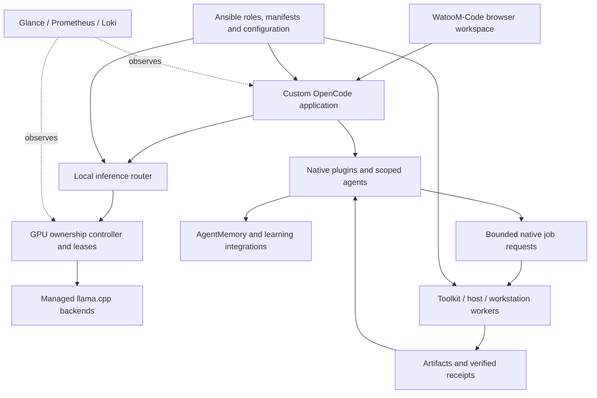

# WatooM LLM Platform

A self-hosted coding and creative-work environment: customised OpenCode/WatooM-Code, local llama.cpp inference, guarded native plugins and agents, persistent memory, asset workers, and Ansible-managed infrastructure.

This repository brings the application source and the surrounding platform together. It is a source distribution of an existing homelab deployment. It is **not yet a qualified clean-machine installer**: inventory, paths, private-registry images, model files and optional worker dependencies must be configured for the destination host.

## Documentation

| Start here | Details |
|---|---|
| [Operator manual](standardised_k3s_project/docs/guide/operator-manual.md) | Step-by-step fix, approve, restart, stop and start procedures, approval gates and helper commands for a non-author operator |
| [Project guide](standardised_k3s_project/docs/guide/llm-project.md) | Requirements, installation, configuration, operation, tests and troubleshooting |
| [Software design](standardised_k3s_project/docs/guide/software-design.md) | Components, request flows, trust boundaries and source/runtime ownership |
| [Custom extensions](standardised_k3s_project/docs/guide/llm-extensions.md) | Native plugins, agents, skills, workers and integrations |
| [User guide](standardised_k3s_project/docs/guide/llm-user-guide.md) | Browser workflows, projects, models and jobs |
| [API reference](standardised_k3s_project/docs/guide/llm-api.md) | Native application, router, GPU controller, Model Manager and Toolkit contracts |
| [Server automation](standardised_k3s_project/docs/guide/server-catalogue.md) | Scripts, playbooks, roles, helper modules and validation tools |
| [Operations](standardised_k3s_project/docs/guide/operations.md) | Component deployment, validation tiers and change control |
| [Source publication](standardised_k3s_project/docs/guide/llm-publication.md) | Provenance, exclusions, source/image pins and distribution updates |

Glance renders the same maintained Markdown sources into the internal operations guide. Do not edit generated HTML directly.

## Scope

This repository is the **AI platform only**: local LLM serving (llama.cpp, router, GPU controller, Model Manager), the WatooM-Code agent application, memory and search, observability, the game/creative workers (Godot, Blender, Unreal, MetaHuman, Fab, Bazzite and rig lanes) and the k3s/host base they need. Media, game-server, DNS/VPN, password-manager, Kali/security-agent, ESP32, backup/recovery and rebuild tooling from the original homelab are not included. The cut is defined in `standardised_k3s_project/tools/git/llm-platform-publication-policy.json` (`scope`). The shared monitoring manifest also includes a router-metrics collector; remove it there if you don't want router monitoring.

## Adapting to your machine

1. Copy `standardised_k3s_project/ansible/inventory.example.ini` and set your host.
2. Move the disk locations to yours with one command (review the diff afterwards):
   `python3 standardised_k3s_project/tools/set-paths.py --data-root /srv/ai --app-root /srv/app --repo-root "$(pwd)/standardised_k3s_project" --dry-run`
   then run it again without `--dry-run`. `--data-root` holds models, memory and projects; `--app-root` holds small service state; `--repo-root` is this checkout.
3. Replace the environment placeholders with your own values (domain, LAN addressing, GitHub account). The source ships with `homelab.example`, `10.99.x.y`, `192.168.250.225` and `YOUR_GITHUB_USER` instead of the original author's values:
   `python3 standardised_k3s_project/tools/set-domain.py --domain lab.mydomain.net --subnet 10.10 --github-owner you --dry-run`
   then run it again without `--dry-run`. Only the options you pass are changed.
4. Put your GGUF models under `<data-root>/models/gguf/` (see `manifests/10-infrastructure/llm`).
5. Worker machines (Linux/Windows) are optional; see [Worker setup](standardised_k3s_project/docs/WORKER_SETUP.md) for what is scripted and what you do by hand.

## Architecture



The application does not own host administration. GPU model transitions go through the controller; heavy workers have explicit resource and scope boundaries. A queued job is not a completed job, and a rendered image is not independent visual acceptance.

## Included customisation

- Coordinator guard: serial delegation, durable budgets, child identity and visual evidence rules.
- Image scope: project/output boundaries for native image operations.
- Self-learning and memory: native lesson/context integration and guarded optimisation.
- Homelab workspace: project-scoped capability and source policy.
- Language knowledge: native language/API reference lookup and card generation tooling.
- SearXNG search integration and configured native agent/skill catalogue.
- Application/UI changes, project selection, plugin interfaces and package-specific source/tests.
- Model routing and GPU ownership, Toolkit, Blender/Godot/Unreal/Fab and remote workstation bridges.
- Release fences, maintenance tools, observability, manifests, playbooks and roles for the k3s host base.

Upstream OpenCode packages and third-party dependencies are retained with attribution. Inclusion is not a claim that WatooM authored upstream code or enabled every package. See [THIRD_PARTY.md](THIRD_PARTY.md).

## Source layout

```text
application/                  pinned customised OpenCode source and lockfiles
standardised_k3s_project/
  ansible/                    installation owners, defaults, tasks and release pins
  config/                     source configuration and Glance guide inputs
  manifests/                  Kubernetes workloads/services and supporting policies
  scripts/                    operator commands, renderers and checks
  tools/                      controllers, plugins, workers, release tooling and tests
  docs/                       design, API/user/operations guides and source inventory
publication/                  source provenance, per-file hashes and export review
```

## Getting started

1. Read the [project guide](standardised_k3s_project/docs/guide/llm-project.md) and choose the component you intend to build or deploy.
2. Review `publication/provenance.json` and `ansible/vars/watoom-code.yml` for independent source/image identities. Paths in this step are relative to `standardised_k3s_project/` unless prefixed with `publication/`.
3. Configure an isolated destination inventory, private credentials, storage paths and registry images. Model weights and optional engines/assets must be acquired separately under their licenses.
4. Validate source and apply only the owning component playbook. Never run every script as an installer.
5. Verify real application/API readiness, model routing, worker receipts and rollback behaviour before accepting a deployment.

For application development, use the Bun version declared in `application/package.json`, the existing lockfile and the affected package's scripts. The upstream application deliberately rejects root-level `bun test`; choose the relevant package. The platform build helper accepts explicit `--source`, `--bun`, `--godot`, `--output`, `--tag` and engine parameters; inspect its pinned toolchain checks before use.

## Documentation checks

From `standardised_k3s_project/`, with the pinned documentation dependencies available:

```bash
python3 scripts/render-server-catalogue.py --check
python3 scripts/render-glance-guide.py --check
python3 scripts/verify-homelab-documentation.py
python3 docs/llm-platform/validate.py
python3 -m unittest discover -s docs/llm-platform/examples -p 'test_*.py'
```

Install documentation packages into a dedicated virtual environment from `scripts/requirements-docs.txt`; the server already has `/data/ai/toolchains/docs-render`. These checks verify documentation and reference-client contracts, not a full runtime deployment. Use the component-specific tests described in the project guide for behaviour changes.

## Current deployment status

Snapshot of 12 November 2026: platform source `3ccbe2a5` and application pin `440fb4d1` (see `publication/provenance.json`). The application/Toolkit/AgentMemory image pins remain independent; see `ansible/vars/watoom-code.yml`.

Since the previous snapshot this adds:

- An [operator manual](standardised_k3s_project/docs/guide/operator-manual.md) published in the Glance guide.
- RIG async-stage fixes: the stale duplicate game-worker bridge was removed, renderer provenance pins and stage configuration were re-synchronised, and a release-pinned dispatcher with a pull-only rig worker is the supported layout. The `Install-StageWorker.ps1` default root still differs from the live layout (`rig-async-stage-<date>`); set it explicitly.
- Agent prompt rules: a reviewer after file-changing builder packages, conditional investigation before building, and `watoom_memory_learn` available to the critic, investigator and reviewer with evidence taken only from the agent's own direct calls in the current session.
- Web search: SearXNG now serves github, stackoverflow, pypi, bing, yandex, crates.io and pkg.go.dev in the general category, the native `websearch` provider returns up to 30 results and strips `OR`/`AND`, and agents fall back to direct `webfetch` when search fails.
- Llama.cpp per-slot context checkpoints capped at 12 (`LLAMA_ARG_CTX_CHECKPOINTS`) with a re-pinned controller digest.
- The separate production/stage/semi-production application playbooks and vars were retired in favour of `playbooks/watoom-code.yml` and `ansible/vars/watoom-code.yml`.

Backup/recovery and replacement-host rebuild tooling are not part of this distribution (see Scope).

## Distribution limits

Secrets, session databases, runtime backups, private recovery grants, model weights, purchased assets, engine source and source Git history are not included. One embedded deployment secret was replaced with a placeholder in the exported manifest. The existing operator repository and production services are unchanged by creating this distribution.

WatooM-authored code is released under the [MIT License](LICENSE); OpenCode and other third-party components keep their own licenses (see [LICENSE-NOTICE.md](LICENSE-NOTICE.md)). The installation has not been qualified on a clean machine: resolve external source/build requirements for your environment and review the credential and privacy posture of your own deployment before exposing anything.

See [CONTRIBUTING.md](CONTRIBUTING.md), [SECURITY.md](SECURITY.md), [THIRD_PARTY.md](THIRD_PARTY.md) and [LICENSE-NOTICE.md](LICENSE-NOTICE.md).
